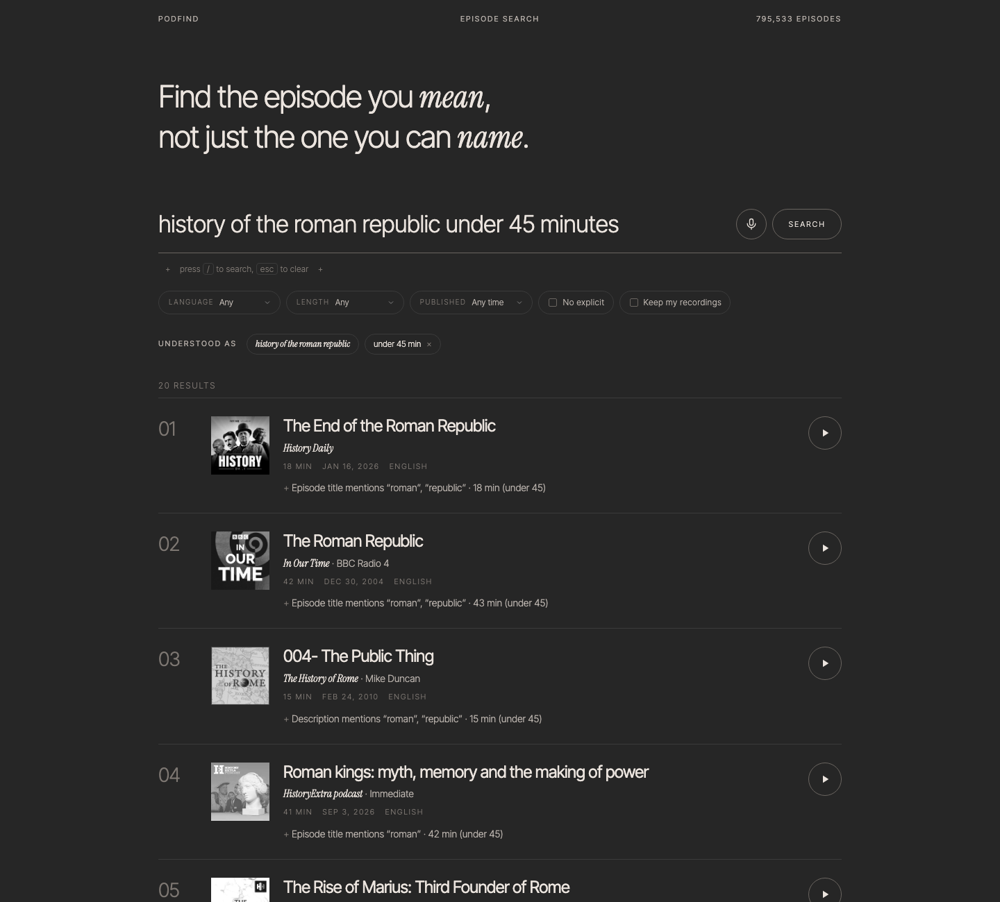

# PodFind

Podcast search over ~800k episodes: hybrid lexical + vector retrieval, a
fine-tuned two-tower model, and an evaluation setup honest enough to say
when the model loses.

Type or say what you want — *"English episodes under 45
minutes about practical uses of AI, published this year, no explicit
content"* — and get episodes back, ranked, with the constraints enforced
as hard filters. It runs at
[api-production-0ff59.up.railway.app](https://api-production-0ff59.up.railway.app).



## What exists

| Part | State |
|---|---|
| Catalog | Go worker: podcast discovery (Particle), RSS polling on an adaptive schedule, deduplication, publisher transcript parsing. 1,788 shows, ~796k episodes, ~87k transcripts. |
| Lexical search | PostgreSQL full-text search, weighted across episode, transcript, and show fields, per-language configs, hard filters for language, duration, date, explicit. |
| Vector search | `multilingual-e5-small` embeddings in `pgvector` with HNSW, plus a versioned index per fine-tuned model. |
| Hybrid | Reciprocal-rank fusion of the lexical and vector rankings. |
| Relevance set | 180 queries (navigational, entity, exploratory, filtered), 71,518 graded judgments pooled from every system under comparison, LLM-graded with human override. |
| Evaluation | Recall@K, hit rate, MRR, NDCG@10, coverage, cohort recall, latency, judged share; one config per system, runs logged to MLflow. |
| Datasets | Deterministic builder: snapshot + config + code revision → identical versioned Parquet splits. Generators for title queries, weak topic labels, and LLM-written queries with mined hard negatives. |
| Learned ranker | LightGBM LambdaRank over the union of lexical, E5, and two-tower candidates; 31 shared feature definitions; query-grouped cross-validation. |
| Two-tower model | PyTorch, shared E5 encoder, structured episode features, shared training/serving feature contract, resumable training with judged-pool validation, distillation, hard-negative mining and auditing, acceptance gates with MLflow registration. |
| Serving | Go API with query understanding, concurrent three-leg retrieval, reranking through an ONNX model server, stored searches, attributed impression and playback events, and the web app. A model bundle is promoted only after training-serving parity checks pass. |
| Voice | Recording in the web app, local Whisper transcription through a speech server, an editable transcript, consent-gated retention, and session export and deletion. A synthetic speech test set and a voice-robustness report quantify what transcription costs retrieval. |
| Web app | Static files served by the API: one search with voice and a live level meter, filters as pills, the understood query as removable chips, an editable transcript, numbered results with explanations and one shared player, data export and deletion, a light theme, shareable URLs, a web app manifest. Lighthouse 100 on every category. |
| Deployment, monitoring | Railway from `.railway/railway.ts`: one image per process, Postgres with pgvector, buckets, Prometheus and Grafana with alert rules, a scheduled drift check shown to catch a real serving skew, and a load tester for the SLOs. |

## Results so far

On the 180-query relevance set, latest judgment pool:

| system | NDCG@10 | MAP@10 | Recall@100 |
|---|---|---|---|
| lexical full-text search | 0.538 | 0.507 | 0.261 |
| pretrained E5 vector search | 0.720 | 0.730 | 0.369 |
| fine-tuned two-tower | 0.758 | 0.770 | 0.421 |
| RRF over lexical, E5, and two-tower | 0.766 | 0.782 | 0.475 |
| learned ranker over the same candidates | 0.794 | 0.817 | 0.514 |

The fine-tuned two-tower model is trained on LLM-written queries plus
show-name and publisher-name queries, with lexical-mined and random
negatives, and is the registered champion; it beats E5 on NDCG@10 and
Recall@100 outside noise. A LightGBM ranker reorders the top 50 of all
three legs and beats RRF on NDCG@10 and MAP@10 outside noise, at about 10
ms per query (ranker numbers are out of fold over the 180 queries). The
full hybrid pipeline is not yet within the 500 ms p95 search budget
because the three retrieval legs run in sequence. Lexical search keeps
the edge on relevant episodes found only through their transcripts. Mined hard negatives from vector search
turned out to be one-fifth false negatives and hurt. Ablations show the
model's quality comes entirely from content features, and its gains over
E5 hold for shows it never trained on. Its known failure modes are listed
in the [model card](docs/model-card.md). Write-ups:
[baseline report](experiments/baseline-report.md),
[two-tower runs](experiments/two-tower-first-run.md),
[negative sampling](experiments/negative-sampling-report.md),
[name queries](experiments/name-queries-report.md),
[ablations and cold start](experiments/ablation-cold-start-report.md),
[learned ranker](experiments/ranker-report.md).

## Layout

```
cmd/            Go entry points: api, catalog-worker, migrate (ml-worker is a scaffold)
internal/       Go packages: api, search, catalog, rss, transcript, discovery, jobs, outbox, objstore
migrations/     PostgreSQL schema
ml/             Python: datasets, features, models, training, embeddings, retrieval, ranking, serving, speech, relevance, evaluation
web/            Web app served by the API
experiments/    Checked-in dataset, training, and eval configs, and reports
data/           Relevance set (tracked); snapshots, datasets, models (local)
docs/           Documentation, data card, licensing notes
```

## Running it

Requires Go 1.26+, [uv](https://docs.astral.sh/uv/), and Docker; on macOS,
`brew install libomp` for LightGBM.

```sh
cp .env.example .env            # optional: Particle API key for discovery
docker compose up -d postgres objstore mlflow
make migrate
make ci                         # lint, tests, build

docker compose up -d catalog-worker            # ingestion (see docs/09-catalog.md)
make embed                                     # E5 vectors for the catalog
make eval-all                                  # every system against the relevance set
make snapshot && make dataset                  # versioned training data
make train && make index                       # two-tower model and its index
make train-ranker                              # the learned ranker

make bundle                                    # ONNX serving bundle, printed as data/serving/bundles/<id>
export BUNDLE=data/serving/bundles/<id>
make golden && make prewarm
make serve-models &                            # model server on :8081
make serve-speech &                            # speech server on :8082 (voice search; optional)
PODFIND_DEBUG=1 PODFIND_LEXICAL_TIMEOUT_MS=60000 PODFIND_VECTOR_TIMEOUT_MS=60000 make api &
make parity API=http://localhost:8080 && make promote   # parity gates promotion; restart the API without debug after
```

Then open http://localhost:8080. `make monitoring` adds Prometheus and
Grafana on http://localhost:3000. The deployed system runs on Railway
from `.railway/railway.ts`; see [docs/11-deployment.md](docs/11-deployment.md).

Every target is in the [Makefile](Makefile); the docs start at
[docs/00-overview.md](docs/00-overview.md).

## Data responsibilities

Podcast metadata, artwork, and transcripts delivered over public RSS remain
the property of their publishers. This project stores only required
metadata, never downloads audio, preserves attribution, and honors removal
requests. See [docs/licensing.md](docs/licensing.md).
