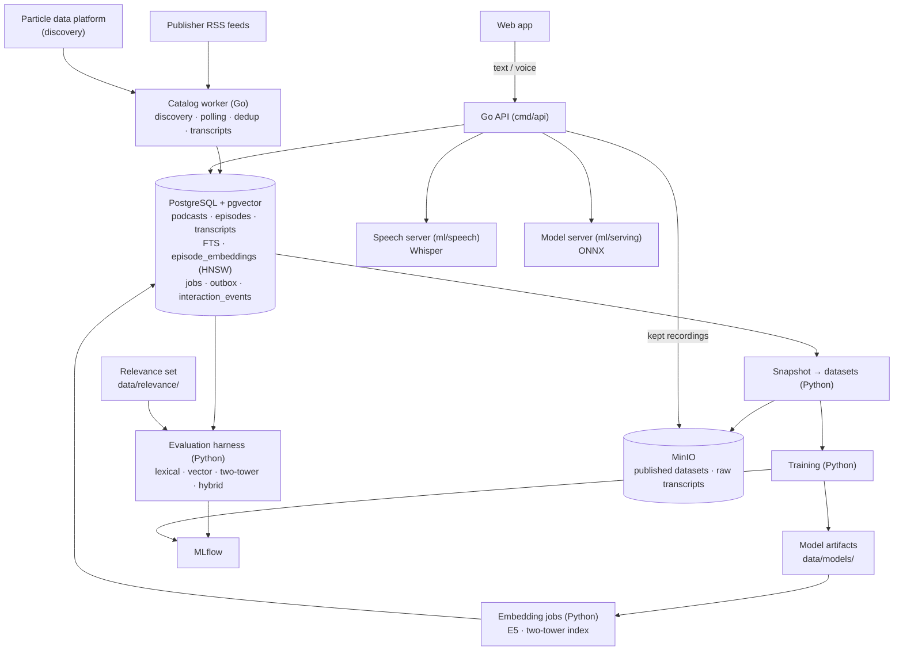

# Architecture

## Components

**Catalog worker (Go, `cmd/catalog-worker`).** Discovers podcasts through
the Particle data platform (search and trending), ingests their RSS feeds,
deduplicates episodes, parses publisher transcripts, and reschedules each
feed by how recently it published. Work runs through a PostgreSQL job
queue (`internal/jobs`); state changes and their domain events commit
together through a transactional outbox (`internal/outbox`).
[09-catalog.md](09-catalog.md)

**Database (PostgreSQL + pgvector).** The only store for catalog data,
transcripts, full-text indexes, embeddings, jobs, events. Embeddings are
keyed by `(episode_id, model)` so several models coexist, each with a
partial HNSW index. [10-database.md](10-database.md)

**Retrieval (Python, `ml/retrieval`).** Four systems behind one interface
(`search(query, k) -> episode ids`): PostgreSQL full-text search,
pretrained E5 vector search, fine-tuned two-tower vector search, and hybrid
reciprocal-rank fusion. Structured filters are hard SQL predicates in
every system. [04-retrieval.md](04-retrieval.md)

**Embedding jobs (Python, `ml/embeddings`).** Batch-encode the catalog
into `episode_embeddings`, resumable and content-hash aware, one job for
the pretrained model and one for any two-tower artifact.
[05-embeddings.md](05-embeddings.md)

**Datasets (Python, `ml/datasets`).** An immutable snapshot of the
database plus a checked-in config and the code revision produce identical
versioned Parquet splits. Optional raw inputs (LLM-written queries, mined
negatives) are content-hashed into the manifest.
[03-data-pipeline.md](03-data-pipeline.md)

**Training (Python, `ml/training`, `ml/models`).** The two-tower model
and its loop; artifacts record architecture, feature contract, dataset
version, code revision, metrics, and intended use.
[08-models.md](08-models.md)

**Relevance and evaluation (Python, `ml/relevance`, `ml/evaluation`).**
Query set, candidate pooling, LLM judging with human override, qrels
export, and the metrics harness. [06-relevance.md](06-relevance.md),
[07-evaluation.md](07-evaluation.md)

**MLflow.** Tracking server in Docker Compose; every evaluation and
training run logs there. **MinIO** holds published dataset versions and
raw transcript files.

**Serving.** The Go API (`cmd/api`, `internal/search`) runs query
understanding, three concurrent retrieval legs against PostgreSQL, and
reranking through the model server (`ml/serving`, ONNX Runtime over one
immutable model bundle), stores every search, and records attributed
interaction events. It also serves the web app (`web/`). Details in
[14-serving.md](14-serving.md).

**Voice (Go API + `ml/speech`).** A spoken query is a WAV recording the
API sends to the speech server (Whisper, locally), then searches as text.
The transcript is stored with the search, the recording is not kept
unless the user asks, and a session can export or delete all its data.
A synthetic speech test set measures what transcription costs retrieval.
[15-voice.md](15-voice.md)

Not built: the ML worker (`cmd/ml-worker` prints its version and exits),
deployment manifests, and monitoring.

## Data flows

**Ingestion:** feed → catalog worker → `podcasts`/`episodes`/`transcripts`
(+ outbox events, `content_hash` per episode) → embedding jobs re-encode
what changed.

**Training:** `make snapshot` → `make dataset` → `make train` → artifact →
`make index` → evaluate with `make eval`.

**Evaluation:** `queries.jsonl` + `qrels.txt` → harness runs a system
against the live catalog → metrics to MLflow and, for reports, to
`experiments/`.

## Design choices

- **One database.** Lexical index, vectors, jobs, and events all live in
  PostgreSQL. At ~800k episodes this is comfortable and removes a class of
  consistency problems; a dedicated vector store is not needed at this
  scale.
- **Go for ingestion, Python for ML.** The worker is long-running,
  I/O-bound, and needs a small footprint; the ML side needs PyTorch,
  transformers, and pandas. They share the database, not code.
- **Reproducibility by construction.** Datasets embed a content hash in
  their version; artifacts embed the training-config hash in their name;
  every metric has a checked-in config.
- **Pooled, extensible ground truth.** Judgments are pooled from the
  systems under comparison and extended whenever a new system is
  evaluated, because unjudged results count as irrelevant.
