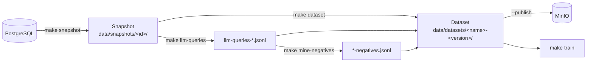

# Data pipeline

## Snapshots

`make snapshot` (`ml/datasets/snapshot.py`) exports `episodes.parquet`
(catalog columns plus a 4,000-character transcript excerpt),
`podcasts.parquet`, and a `manifest.json` with file hashes into
`data/snapshots/<id>/`, where the id is derived from the file hashes.
`data/snapshots/latest` points at the newest one. Capturing a snapshot is
the only non-deterministic step; everything downstream is a pure function
of a snapshot, a config, and the code.

## Datasets

`make dataset CONFIG=experiments/datasets/<config>.json` (`ml/datasets/build.py`)
builds one dataset from a snapshot: generators produce rows in the shared
training-example contract (`ml/datasets/contracts.py`,
[data/contracts/training-example.md](../data/contracts/training-example.md)),
rows are validated (schema and label-composition checks), split by
`event_time` into train / validation / test, and written as Parquet with
a manifest. The version is `<base_version>-<content hash>`, so rebuilding
the same inputs yields the same version byte for byte, and any change to
the rows changes the version.

Generators:

| type | query | positive | label class |
|---|---|---|---|
| `synthetic_query` | normalized episode title | that episode | synthetic |
| `topic_similarity` | a category name | an episode of a show in that category | weak |
| `llm_query` | an LLM-written search for the episode | that episode | synthetic |

Negatives: random catalog episodes by default; `llm_query` mixes mined
hard negatives, popularity-weighted episodes, and random ones.

Checked-in configs: `search-bootstrap-v1.json` (titles + topics, English),
`search-bootstrap-v2.json` (same, all languages),
`search-llm-v1.json` (LLM queries with mined negatives).

## Raw inputs beyond the snapshot

Two optional inputs live next to the snapshot and are hashed into the
dataset manifest (`inputs`), so a dataset stays reproducible even though
producing them is not deterministic:

- `llm-queries-<model>.jsonl` — one natural-language query per sampled
  episode, written by an LLM (`make llm-queries`,
  `ml/datasets/llm_queries.py`), resumable and shardable.
- `llm-queries-<model>-negatives.jsonl` — hard negatives mined for those
  queries with the baseline retrievers (`make mine-negatives`,
  `ml/hard_negatives/mine.py`): top-50 candidates from vector and lexical
  search minus the positive and its show.

## Validation

`ml/datasets/validate.py` runs the schema (types, uniqueness, id lists,
positive not among negatives or in history, no future timestamps) and a
distribution report (label class shares, distinct positives, negatives per
example) with per-dataset thresholds from the config. A build that fails
validation writes nothing.

## Publishing

`--publish` uploads a built dataset to the MinIO `datasets` bucket under
its version; an existing version is never overwritten.

## Relevance data

The relevance set is separate from training data and tracked in git:
[06-relevance.md](06-relevance.md).
