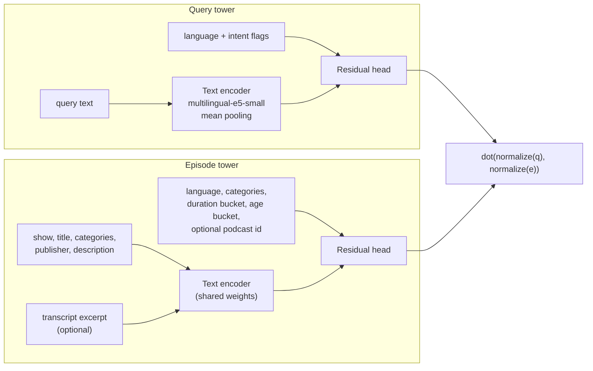

# Models

Two kinds of model are in use: the pretrained embedding model that powers
`vector-e5-small` ([05-embeddings.md](05-embeddings.md)), and the two-tower
retrieval model fine-tuned from it. A learned reranker is planned but not
built.

## Two-tower retrieval model

Code: `ml/models/two_tower/` (model), `ml/features/` (feature contract and
featurizer), `ml/training/` (loop, data, loss).



**Objective.** Both towers emit unit vectors; the score is their dot
product, divided by a fixed temperature (0.05) for the contrastive softmax.

**Design.**

- One `multilingual-e5-small` backbone serves both towers (E5's `query:` /
  `passage:` prefixes keep the sides asymmetric); separate encoders are a
  config switch.
- Each tower is `text_vector + head(features)` with the head's last layer
  zero-initialized, so an untrained model is numerically identical to the
  pretrained baseline (verified to 1e-7). Fine-tuning can only move away
  from the baseline where the data says so.
- Episodes with a transcript get a second encoder pass over its first
  ~2,000 characters plus a flag; the rest get zeros. Structured features
  are learned embeddings; publication age is computed against a
  caller-supplied reference time (example event time in training, index
  build time in the index job).
- Ablations are config switches (`episode_text`, `use_transcript`,
  `use_structured`, `podcast_id_buckets`, `share_text_encoder`,
  `query_context`).

**Feature contract** (`ml/features/contract.py`): text model and prefixes,
token budgets (64 query / 256 metadata / 256 transcript), language and
category vocabularies built from a snapshot, duration and age bucket
edges. It is saved with every artifact and fingerprinted; the featurizer
is built from it, so training and index time cannot compute features
differently without changing the fingerprint. The first fine-tuned run
failed on exactly this kind of skew: see the report.

## Training

```sh
make train TRAIN_CONFIG=experiments/training/two-tower-v3.json
uv run python -m ml.training.train --config <cfg> --max-steps 20 --no-mlflow   # smoke run
uv run python -m ml.training.train --config <cfg> --resume                     # continue a checkpoint
```

`ml/training/train.py` reads a versioned dataset and the snapshot it was
built from (it refuses any other snapshot), builds the contract from that
snapshot, and trains with:

- **Loss** — contrastive softmax over a candidate block of in-batch
  positives plus each example's own negatives; candidates that are the
  query's positive episode, or the positive of an example with identical
  query text, are masked.
- **Optimization** — AdamW with separate encoder and head learning rates,
  warmup then linear decay, gradient clipping, optional gradient
  accumulation (`accumulate_steps`), gradient checkpointing, and
  `trainable_encoder_layers` to freeze the token embeddings and lower
  layers (which hold most of the parameters and most of the memory).
- **Distillation** — `distill_weight` adds `1 − cos` against the frozen
  pretrained encoder on both towers, so fine-tuning cannot drift far from
  the baseline it must beat.
- **Training-time augmentation** — `age_jitter_days` moves each example's
  age reference forward by a seeded log-uniform delay so every age bucket
  is trained; `query_language_prob` attaches the positive's language to
  the query as context.
- **Validation** — with `pool_validation_dir`, every `eval_every` steps
  the model re-ranks each relevance-set query's judged candidates
  ([07-evaluation.md](07-evaluation.md)); the best checkpoint by pool
  NDCG@10 is the one saved as final. The candidate-set accuracy alone
  saturates within a few hundred steps and cannot select a checkpoint.
- **Checkpoints** — every validation pass saves the artifact plus
  optimizer and scheduler state; `--resume` continues it, and the loop
  saves on interrupt.
- **Tracking** — parameters and per-step metrics go to MLflow experiment
  `two-tower-training` (asynchronously). `ml/training/sync_run.py` copies
  a run logged to a local SQLite store into the server, for training with
  Docker stopped.

## Artifacts

```
data/models/<name>-<dataset version>-<config hash>/
├── artifact.json           architecture, embedding dim, parameters, contract fingerprint,
│                           git revision, dataset version and hash, training config,
│                           steps, best step, metrics, intended use, MLflow run id
├── model_config.json
├── feature_contract.json
├── backbone/config.json    encoder architecture (loads without hub access)
├── tokenizer/
├── weights.pt
├── training_state.pt       optimizer + scheduler state for --resume
└── index.json              written by make index: build time, vector count
```

`TwoTowerModel.load(dir)` and `Featurizer.load(dir)` rebuild both halves.
`make index ARTIFACT=<dir>` encodes the catalog with the episode tower
into `episode_embeddings` under `two-tower:<artifact name>`, after which
the `two-tower` and `hybrid-rrf` systems can read it.

## Hard negatives

`make mine-negatives` (`ml/hard_negatives/mine.py`) retrieves, for every
training query, the top-50 candidates from pretrained vector and lexical
search, drops the positive and its show, and writes them next to the
queries file; the `llm_query` dataset generator samples from them. Random
negatives are almost never topically close, so a model trained on them
only learns to separate unrelated episodes; mined negatives are what the
baselines actually confuse with the positive.

`make audit-negatives` (`ml/hard_negatives/audit.py`) grades a sample of
mined negatives with the relevance judge's rubric to measure how many are
false negatives — relevant episodes the single-positive label leaves
unlabeled — by mining rank and by source.

## Registration

`make gates` runs the acceptance gates in [07-evaluation.md](07-evaluation.md)
and, with `--register`, records the artifact in the MLflow model registry
with the gate outcome. A model becomes `champion` only by passing every
gate; anything else is a `candidate`.

## Results and status

[experiments/two-tower-first-run.md](../experiments/two-tower-first-run.md)
records the first three runs and
[experiments/negative-sampling-report.md](../experiments/negative-sampling-report.md)
the controlled negative-strategy comparison. The best model so far
(`two-tower-llm-random-negatives`: LLM-written queries, random negatives)
beats the pretrained baseline on Recall@50/100, tail coverage, every
relevant-item cohort, and exploratory queries, but not on NDCG@10 or name
queries, so it fails the gates and is registered as `candidate`
(`podfind-two-tower` v1); the pretrained index stays in place. Mined hard
negatives hurt until cleaned of false negatives.

Export to ONNX for serving is planned and not built.
