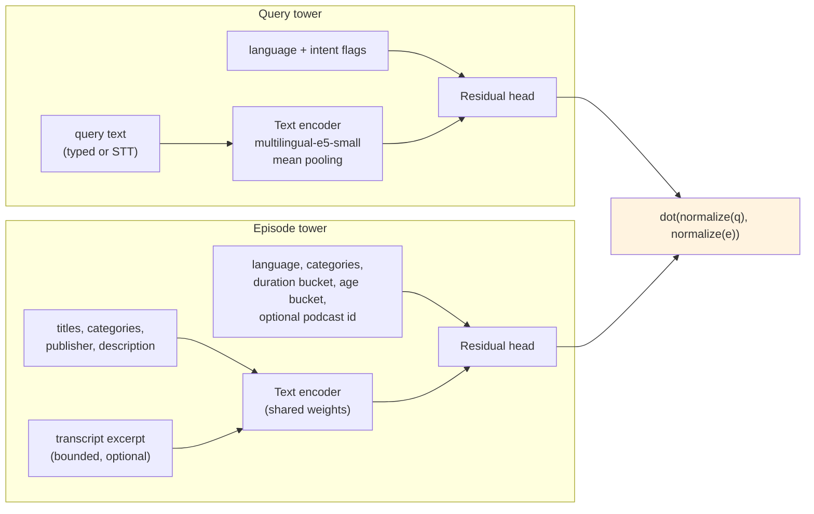
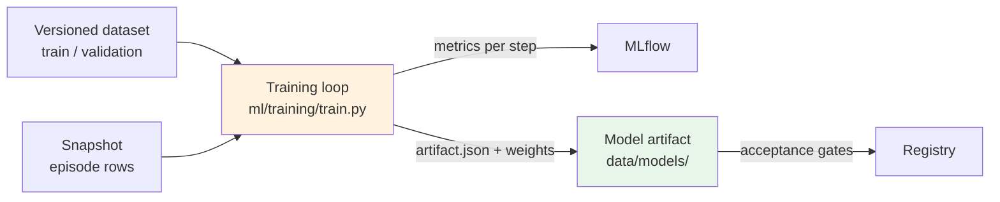
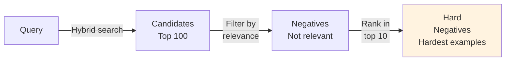

# Models: Training, Evaluation & Export

ML models power PodFind's semantic search and future reranking.

## Model Types

### Embedding Models (Current)

**Purpose**: Convert text to vectors for semantic search.  
**Current**: intfloat/multilingual-e5-small (384-dim)

See [05-embeddings.md](05-embeddings.md) for model details and inference strategy.

### Two-Tower Retrieval Model

**Purpose**: Fine-tuned semantic retrieval that must beat the pretrained
embedding baseline on the relevance set.
**Code**: `ml/models/two_tower/` (model), `ml/features/` (feature contract
and featurizer).



**Objective**: both towers emit unit vectors in one space; the score is
their dot product, and training divides it by a fixed temperature (0.05)
before the contrastive softmax.

**Design decisions:**

- **Shared text encoder.** One `multilingual-e5-small` backbone serves both
  towers (E5's `query:` / `passage:` prefixes keep the sides asymmetric).
  Separate encoders are a config switch, not the default: they double the
  parameters without adding data.
- **Starts at the baseline.** Each tower is `text_vector + head(features)`
  with the head's last layer zero-initialized, so an untrained model is
  *numerically identical* to the pretrained-embedding baseline (verified to
  1e-7 against `SentenceTransformer`). Fine-tuning can only move away from
  the baseline where the data justifies it, and any regression is a
  training effect, not an architecture artifact.
- **Bounded transcript pass.** Episodes with a transcript get a second
  encoder pass over its first ~2,000 characters (256 tokens); the rest get a
  zero vector plus a `has_transcript` flag. Only rows with transcripts are
  encoded, so the ~9% transcript coverage costs ~9% extra compute.
- **Structured features as embeddings.** Language, duration bucket, and
  publication-age bucket are learned embeddings; categories are the mean of
  learned category embeddings. Publication age is computed against a
  reference time the caller supplies (example event time in training,
  request time online) so both paths use one definition.
- **Learned podcast id, off by default.** A hashed podcast-id embedding is
  available for collaborative signal once interaction data exists; the
  bootstrap datasets have none, so it stays disabled.
- **Ablations are config switches.** `episode_text`, `use_transcript`,
  `use_structured`, `podcast_id_buckets`, `share_text_encoder`, and
  `query_context` in `TwoTowerConfig` produce the metadata-only,
  metadata+transcript, id-only, and combined variants from one code path.

**Feature contract** (`ml/features/contract.py`): the text model and its
prefixes, token budgets (64 query / 256 metadata / 256 transcript), the
language and category vocabularies built from a catalog snapshot, and the
duration and age bucket edges. It is saved with every model artifact and
fingerprinted (SHA-256); the featurizer is constructed from it, so training
and serving cannot compute features differently without changing the
fingerprint.

**Model artifact layout:**

```
<artifact>/
├── artifact.json           # architecture, embedding dim, parameter counts,
│                           # contract fingerprint, git revision, plus
│                           # training metadata (dataset version, metrics, use)
├── model_config.json       # TwoTowerConfig
├── feature_contract.json   # FeatureContract
├── backbone/config.json    # text-encoder architecture (no hub access to load)
├── tokenizer/              # the contract's tokenizer
└── weights.pt              # full state dict
```

`TwoTowerModel.load(dir)` and `Featurizer.load(dir)` rebuild both halves
from the directory alone.

**Versioned index**: `make index ARTIFACT=<dir>` runs the episode tower
over the live catalog (`ml/embeddings/two_tower_index.py`) and upserts the
vectors under `two-tower:<artifact name>` in `episode_embeddings`, with a
partial HNSW index per artifact; `index.json` records the build. The
`two-tower` retrieval system and the `hybrid-rrf` two-tower leg then read
that index, so `make eval` compares a trained model against the baselines
on identical catalog rows.

**Measured** (laptop, Apple GPU, batch 64, untrained weights): ~216
episodes/s through the full episode tower including the transcript pass;
featurization ~5,000 rows/s. The median episode fills the 256-token
metadata budget, so descriptions are truncated for most of the catalog.

### Reranker Models (Future)

**Purpose**: Second-stage ranking to refine the fused candidate set. The
planned ranker is a gradient-boosted tree model over two-tower similarity,
lexical score and rank, exact-match indicators, freshness, popularity, and
candidate-source flags; a neural cross-encoder is a challenger that must
justify its latency, not the default.

### Popularity Models (Baseline)

**Purpose:** Simple baseline for ranking episodes by historical popularity.

**Computation:**
```python
# Per-episode popularity score
popularity = {
    'global': listen_count / max_listen_count,
    'by_category': category_listen_count / max_category_listen_count,
    'recency': 1.0 / (1.0 + days_since_published)
}
```

**Usage:** Separate retrieval system in pooling/evaluation.

## Model Training Workflow



**Run training:**
```bash
make train                                   # experiments/training/two-tower-v1.json
make train TRAIN_CONFIG=experiments/training/<other>.json
uv run python -m ml.training.train --config ... --max-steps 20 --no-mlflow   # smoke run
```

**Inputs**: a checked-in training config (dataset directory, model config,
optimizer settings, intended use), the versioned dataset it names, and the
snapshot that dataset was built from — the loop refuses to run against a
different snapshot. The feature contract's vocabularies are built from that
snapshot.

**Loss**: contrastive softmax. Each step encodes the batch's queries and a
candidate block of `[positives | random catalog negatives]` (the negatives
sampled per example when the dataset was built) and takes cross-entropy of
each query's positive over every candidate, so all other examples'
positives act as in-batch negatives. Two masks keep label noise out of the
gradient: a candidate that is the query's own positive episode, or the
positive of an example with identical query text (weak topic labels share
the category name as query), is never treated as a negative.

**Optimization**: AdamW with a small learning rate for the pretrained
encoder and a larger one for the new heads and embeddings, linear warmup
then linear decay, gradient clipping. `trainable_encoder_layers` fine-tunes
only the top N encoder layers (token embeddings and lower layers frozen),
which removes most optimizer state and activation memory. Gradient
checkpointing on the encoder is on by default: each step encodes a batch of
queries plus several hundred 256-token candidates, and recomputing
activations in the backward pass is what makes that fit a laptop GPU's
memory. Label strength can optionally weight examples
(`weight_by_label_strength`).

**Training-time feature augmentation** (`ExampleBatcher`): bootstrap labels
put the event at publication time, so without intervention the model only
ever sees "just published" and the publication-age embeddings the index
actually uses stay untrained — the first fine-tuned run failed exactly this
way (see [experiments/two-tower-first-run.md](../experiments/two-tower-first-run.md)).
`age_jitter_days` moves each example's age reference time forward by a
seeded log-uniform delay so every age bucket is trained;
`query_language_prob` attaches the positive's language to the query as
context so the query tower's language embeddings are trained. Both are
recorded in the artifact's training config.

**Checkpoints and resume**: every validation pass saves the artifact plus
optimizer and scheduler state (`training_state.pt`); `--resume` continues
from it with the same config and data order, and the loop also saves on
interrupt (SIGTERM or Ctrl-C).

**Logged to MLflow** (`two-tower-training`): dataset version, snapshot id,
config and contract fingerprints, code revision, every model and training
parameter; per-step training loss, candidate-set accuracy and MRR, learning
rate; validation loss / accuracy / MRR on a fixed set of validation batches.

**Artifact** (`data/models/<name>-<dataset version>-<config hash>/`): the
layout above, with `artifact.json` extended by dataset version and content
hash, snapshot id, the full training config, steps and epochs completed,
device and wall time, final metrics, the MLflow run id, and the intended
use. Candidate-set metrics are training diagnostics only; the model earns
its place through the relevance-set evaluation (see
[07-evaluation.md](07-evaluation.md)). They saturate quickly on the
bootstrap data — an untrained model already ranks the positive first for
nearly every synthetic title query against in-batch and random negatives —
which is the measured case for hard-negative mining.

**Measured** (laptop, Apple GPU, gradient checkpointing, 16 queries + 80
candidates per step): ~3.2 s/step, so one epoch of the ~51k-example
bootstrap dataset at batch 64 is on the order of an hour. Artifacts are
~470 MB (weights dominate) and live under `data/models/`, which is not
tracked.

### Two-Stage Ranking

```
Hybrid RRF (first-stage)
  ↓ Top 50 candidates
Reranker (second-stage)
  ↓ Re-score
Final ranking (top 10)
```

**Benefit**: Combines breadth (RRF finds diverse candidates) with depth (reranker refines).

## Hard Negatives

Hard negative mining creates challenging training examples.

**Why**: Random negatives are too easy to distinguish; model learns to overfit rather than generalize.

**Strategy**: Select negatives that rank highly in retrieval but are labeled as non-relevant.



**Intuition**: These episodes almost matched but were marked irrelevant—perfect for training discriminative models.

## Model Export & Serving

### Export Formats

| Format | Use Case |
|--------|----------|
| **PyTorch** | Training, fine-tuning |
| **ONNX** | Go inference (portable) |
| **TorchScript** | Python inference |
| **HuggingFace Hub** | Community sharing |

**Workflow**: Train in PyTorch → Export to ONNX → Deploy to Go → Log metrics to MLflow

### Model Registry (MLflow)

Register best checkpoint:
```
MLflow UI → Model Registry → Promote to Production → Serve
```

**Metadata**: Training dataset, git commit, validation metrics (recorded automatically)

## Model Versioning

**Scheme:**
```
reranker-e5small-2026-01-15-v1
       ↑base model    ↑date      ↑iteration
```

**Storage**: Checkpoint + metadata (training dataset, metrics, git commit)

## Best Practices

✓ **Version everything**: Checkpoints, configs, data versions  
✓ **Log to MLflow**: Metrics, hyperparameters, artifacts  
✓ **Evaluate before shipping**: Meet quality gates  
✓ **Reproducible**: Fixed seeds, documented hyperparameters  
✓ **Export for production**: ONNX for Go, TorchScript for Python  

✗ **No data leakage**: Train/val/test splits are separate  
✗ **Don't train on test set**: Use val set for tuning only
