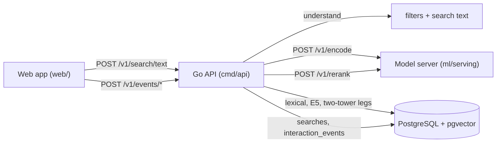

# Serving

The online search path: a model bundle, a model server that runs it, and
the Go API that orchestrates search, stores it, and attributes events.

## Model bundle

`make bundle TWO_TOWER=… RANKER=…` (`ml/serving/bundle.py`) exports, into
`data/serving/bundles/<bundle id>/`:

| file | contents |
|---|---|
| `query_tower.onnx` | the two-tower query tower (encoder, pooling, language/intent context, head, normalization) |
| `e5_query.onnx` | pretrained E5 with mean pooling and normalization |
| `ranker.onnx` | the LightGBM ranker's final model |
| `two_tower_tokenizer.json`, `e5_tokenizer.json` | the tokenizers both encoders were trained with |
| `feature_contract.json`, `ranker.json` | the two-tower feature contract and the ranker's metadata |
| `manifest.json` | file hashes, sources, feature version and list, vector-index model keys, candidate depth |

The bundle id is a hash of the file hashes, so a bundle cannot change
without changing its id. Each export is checked against its source model
before it is written (`ml/serving/export.py`):

- **Query encoders.** Both match PyTorch to about 3e-7.
- **Ranker.** ONNX tree ensembles store split thresholds as float32, while
  LightGBM keeps doubles. A float32 feature equal to a threshold that
  rounded up would go the other way. So the exporter first rounds every
  threshold down to the largest float32 at or below it, which gives the
  same decisions on every float32 input. It then checks the export on
  inputs placed exactly on, and one step above, every threshold. A random
  input check alone missed the original discrepancy.

## Model server

`make serve-models` (`ml/serving/server.py`, FastAPI on port 8081) loads one
bundle, the promoted one in `data/serving/ACTIVE` unless `--bundle` names
another. It refuses to start if any file differs from the manifest, and
never reloads in place. It runs ONNX Runtime only, with no PyTorch or LightGBM.

| endpoint | does |
|---|---|
| `GET /v1/model` | the manifest |
| `POST /v1/encode` | two-tower and E5 query vectors |
| `POST /v1/rerank` | one score per candidate from the evidence rows the API assembled; features computed by `ml/ranking/features.py`, the same code training used; optionally returns the feature matrix |

Query inputs are built without PyTorch (`ml/serving/query_features.py`)
from the bundle's tokenizer files; the parity checks compare them token for
token with the training featurizer.

## Go API

`make api` (`cmd/api`, port 8080) applies migrations, reads the model
server's manifest for the index keys and candidate depth, and serves the
endpoints in [api/openapi/openapi.yaml](../api/openapi/openapi.yaml) and the
web app at `/` ([17-web-app.md](17-web-app.md)).

A search (`internal/search`):

1. **Query understanding** (`understand.go`) pulls hard filters out of the
   text: language ("in Spanish", "English episodes"), duration ("under 45
   minutes", "under an hour"), recency ("this year", "past month", "since
   2025"), and explicit content ("no explicit content", "family friendly").
   The phrase and leftover filler ("published", "episodes about") are
   removed from the search text. Filters from UI controls take precedence.
   The patterns are conservative on purpose: "today" alone is not a date,
   because *Today, Explained* is a show, and "clean" alone is not a
   content filter, because of queries like "clean energy".
2. **Retrieval** (`retrieve.go`). The lexical leg starts at once with its
   own time limit (`PODFIND_LEXICAL_TIMEOUT_MS`, default 300). The query is
   encoded, then the E5 and two-tower legs run, all concurrently. One round
   trip reads every candidate's evidence, and the cosine similarities are
   computed from the stored vectors. A timed-out or failed leg degrades the
   candidate set and is reported per leg. A failed encode or evidence read
   fails the search.
3. **Reranking** through the model server. If it fails, the same candidates
   are ordered by RRF and the search records `ordering: rrf`.
4. **Explanations** (`explain.go`) from matched fields only: show,
   publisher, title, description and transcript matches, satisfied filters,
   and otherwise which retrieval leg found the episode.
5. **Storage.** The search, with its understood query, filters, bundle,
   feature and index versions, per-leg outcomes, timings, and ranked
   results (score and candidate sources per result), goes to `searches`,
   plus a `search` interaction event.

The statements the legs run (`lexical_search`, `vector_search`,
`candidate_evidence`, `candidate_vectors`) and the per-connection vector
settings (`session_settings`) live once in `ml/sql/*.sql`. Python runs them
through psycopg, and the Go package in the same directory embeds them and
rewrites the parameters for pgx. Statements run in exec mode, with no cached
prepared statements: a cached statement can switch to a generic plan, which
cannot use the per-model partial HNSW indexes.

## More like this, and suggestions

`GET /v1/episodes/{id}/similar` returns the nearest episodes to one
episode's own vector in the served index (`ml/sql/similar_episodes.sql`,
shared with the Python evaluation): the two-tower index by default,
`model=e5` for the pretrained one. The source is excluded, the caller's
hard filters apply inside the index scan, and the list is diversified
across shows in Go (`internal/search/similar.go`): five times the limit
is fetched, then other shows are taken first with at most two episodes
per show, and the source's own show fills what remains. The response
carries each result's cosine similarity and a `diversification` block
(candidates seen, cap, same-show results, candidates passed over). The
quality measured without labels (intra-list diversity, novelty, show
coverage, repetition, popularity concentration) is in the
[final report](../experiments/final-report.md).

`GET /v1/suggest?q=` completes two or more typed characters against show
and publisher names (start of the name or of any word in it), eight at
most, most popular first; the web app shows them as the input's
suggestions.

## Interaction events

`POST /v1/events/impression` takes a stored search's `query_id` and the
displayed episodes with their displayed ranks.
`POST /v1/events/playback/{start,progress,skip,complete}` takes an episode,
a position, and optionally the `query_id`. The client sends nothing about
how a result was produced. The API copies the served rank, score, candidate
sources, and the bundle, feature and index versions from the `searches` row
into `interaction_events`, and rejects episodes that were not results of
that search. This is enough to rebuild a training example from any event
later: the query, the candidates' sources, the score, and the exact models
and indexes.

The web app posts an impression for every result it renders and playback
events from the audio element. A playback counts as a skip when another
episode starts before the current one reaches 90%.

## Parity and promotion

`make golden BUNDLE=…` (`ml/serving/golden.py`) runs the training-side
pipeline on 30 queries and stores everything: model inputs, both query
vectors, the candidate set, features, and LightGBM scores. The queries are
six per relevance type, plus edge cases: accents, a query longer than the
tokenizer budget, punctuation only, filters, one word, and mixed case.

`make parity` (`ml/serving/parity.py`) compares production with the golden
set and writes `parity.json` into the bundle.

| check | threshold |
|---|---|
| feature list and version (bundle, ranker, code) | identical |
| tokenizer: serving inputs vs training inputs | identical |
| query vectors: ONNX vs PyTorch | 1e-4; unit norm within 1e-3 |
| ranker: ONNX vs LightGBM on golden features | 1e-4 |
| features: serving path (JSON strings, nulls) vs training | 1e-4 |
| missing values: nulled fields, serving vs training | identical |
| numeric distributions: the ranker's training rows vs serving, same queries | mean shift ≤ 0.05 training SD; no NaN |
| online: bundle, legs, query vectors | served bundle matches; no leg timed out; vectors within 1e-4 |
| online: candidate sets | Jaccard ≥ 0.98 mean, ≥ 0.9 worst |
| online: features of shared candidates | 1e-4 |
| online: scores | 99% within 1e-3 |
| online: top 10 | identical on 95% of queries |

The online checks need the API in debug mode, which accepts a fixed
freshness reference time and verbatim queries and returns every candidate's
features. Its leg limits must sit above the cold-cache worst case, so a slow
lexical query cannot remove candidates.

`make promote BUNDLE=…` (`ml/serving/promote.py`) points `data/serving/ACTIVE`
at the bundle only if it still matches its manifest and its parity report
passed every check, names that bundle, and was computed on its current
golden set. Each promotion is appended to `data/serving/promotions.jsonl`.

## Operations

- **Start order.** Postgres; `make prewarm`; `make serve-models`;
  `make api`. The API waits up to 30 s for the model server.
- **`make prewarm`** (`ml/serving/prewarm.py`) reads the bundle's two HNSW
  indexes, and the table blocks holding their vectors, into the OS cache. A
  cold vector query reads hundreds of random pages from the 15 GB
  `episode_embeddings` table, about 250 ms. Warm, the same query takes
  about 20 ms.
- **Postgres memory.** `docker-compose.yml` raises `shared_buffers` to 2 GB.
  The serving hot set is about 6 GB: about 1.5 GB of index plus 1.3–1.6 GB
  of rows per vector model.
- **`make online-eval`** scores the running API on the relevance set. Its
  ranker numbers are in-sample, because the served model was trained on
  those queries.

Latency, parity results, and the measured effect of the lexical time limit
are in [experiments/serving-report.md](../experiments/serving-report.md).
