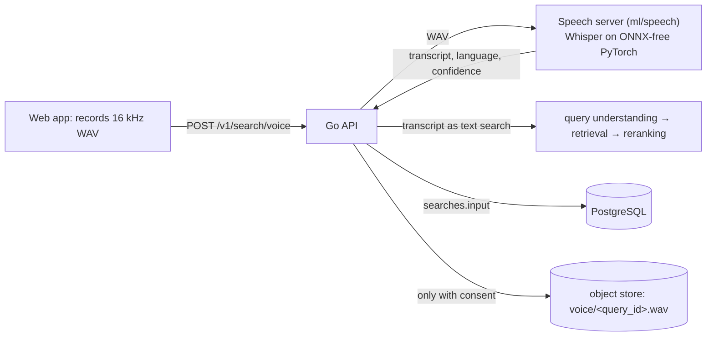

# Voice

Spoken search, measured as a retrieval problem: a recording becomes a
transcript, the transcript becomes a text search, and a speech test set
says how much retrieval loses between the two.

## The voice endpoint

`POST /v1/search/voice` takes a multipart form: the recording as `audio`
(WAV, PCM or float, 8–96 kHz, mono or stereo, at most 30 s and 4 MB) and
the text search's fields (`session_id`, `filters` as JSON, `limit`, an
optional `language` hint, `retain`). The API validates the WAV header,
posts the bytes to the speech server, and runs the transcript through
`Search` exactly as typed text, query understanding included. The
response is the text search's response plus the transcript (text,
language, confidence, recognizer, audio length, transcription time) and
whether the recording was kept.

The search row records how it was entered (`searches.input`):

| mode | set by | carries |
|---|---|---|
| `text` | default | nothing |
| `voice` | the server, on a voice search | the transcript as returned by the recognizer |
| `voice_edited` | the client, when the user corrected a transcript before searching | `parent_query_id`, the voice search it came from |

A client cannot claim mode `voice` or supply a transcript; the server
checks that `parent_query_id` is a voice search of the same session. The
pairs of voice search and edited resend are the record of what the
recognizer got wrong in use.

Query understanding strips spoken framing before retrieval: a leading
command that cannot start a topic ("search for", "find me", "show me",
"play me", "look up", "I'm looking for", "could you find me"), the object
after it ("some podcast episodes about", "a podcast on", "something
about"), and a trailing "please". "Find" and "play" alone are left,
because "play therapy" and "find my phone" are topics.

## The speech server

`make serve-speech` (`ml/speech/server.py`, port 8082) is a second Python
service beside the model server, which stays ONNX-only. It loads one
recognizer, by default Whisper small through `transformers`, on the Apple
GPU when present (`--device cpu` otherwise), and exposes
`POST /v1/transcribe` for a WAV body with an optional `?language=` hint.
It decodes and resamples in memory (`ml/speech/audio.py`), detects the
language when no hint is given, and returns the transcript with a
confidence: the mean log-probability of the generated tokens under the
model, from one teacher-forced decoder pass. On the clips in the test set
a confidence below about −0.4 usually means a wrong name.

`PODFIND_STT=openai:<model>` switches to OpenAI's hosted transcription.
It sends the recording to a third party, so it is off by default and the
backend name is stored with every transcript either way.

## Recordings and data controls

Nothing is written to disk by default. The recording lives in the
request, goes to the speech server, and is dropped when the transcript is
back. With `retain=true` (the web app's "Keep my voice recordings" box)
and an object store configured (`OBJECT_STORE_*`), the WAV is stored
under `voice/<query_id>.wav` and `voice_recordings` records the key, size,
length and the time of consent. Without a store, retention is refused and
the response says so.

The API has no accounts, so the session is the unit of ownership.
`GET /v1/me/data?session_id=…` returns the session's searches (transcripts
included), interaction events and kept recordings; `DELETE` removes them,
objects first so a failure cannot orphan audio. The web app's footer
links both.

## The web app

The microphone button records through the Web Audio API with a live
level meter, downsamples to 16 kHz and encodes 16-bit WAV in the page, so
the server never decodes a compressed container. The transcript lands in
the search box with its language, confidence and length; the user can
correct it and search again, which is sent as a `voice_edited` text
search. Impressions and playback events are posted as for typed search.
The app as a whole is described in [17-web-app.md](17-web-app.md).

## The speech test set

No human recordings of the relevance queries exist, so the set is
synthetic (`make speech-testset SPEECH_CONFIG=…`, `ml/speech/testset.py`),
and two synthesizers are supported:

- **v1, Chatterbox** (`experiments/speech/testset-v1.json`): a local
  neural text-to-speech model speaks each query while cloning a short
  reference recording; the references are macOS system voices in six
  English locales (US, GB, AU, IN, IE, ZA) and four other languages.
  "Accent" therefore means the accent of a synthetic voice as cloned by
  another model. Free and offline.
- **v2, ElevenLabs Eleven v4** (`experiments/speech/testset-v2.json`,
  `ml/speech/elevenlabs.py`): one hosted multilingual model with voices
  from its library chosen by accent and language, so the accents are
  those of real speakers the voices were cloned from. Paid
  (`ELEVENLABS_API_KEY`), and reproducible only as "same voice, model and
  seed", which the manifest records. Terse clips are spoken bare; v4 does
  not hallucinate on short names.

v2 replaced v1 as the reported set, for four reasons found while building
v1. Chatterbox hallucinated or truncated on bare two-word texts (*joe
rogan* came out as *Plotkin*, *the daily wire* as a sentence of noise) in
about four of ten seeds, which forced the carrier phrase and put a
phrasing cost into every terse measurement. Its accents were second-hand:
a model imitating Apple's synthetic voices, so the accent table could not
be read as evidence about speakers. It pins torch 2.6 and numpy 1.x, so it
needs its own environment and lock file. And it takes about five seconds
per clip on the Apple GPU, so a rebuild is an hour of GPU time. Eleven v4
has none of these: bare short names synthesize cleanly, the library
voices carry real speakers' accents, nothing is installed, and 520 clips
take a few minutes. The costs are a paid key, query text sent to a third
party, and reproducibility by (voice, model, seed) rather than bit for
bit. Chatterbox stays as the free, offline option.

Either way the set measures the recognizer on clean, well-articulated
speech; real users will do worse.

| tier | clips | what varies |
|---|---|---|
| base | 180 | every relevance query, terse, in the base voice |
| accent | 300 | a stratified subset of 60 English queries in five other voices |
| conversational | 40 | exploratory and filtered queries phrased as a spoken request |
| condition | 540 | the subset's base clips under white noise (20, 10, 5, 0 dB SNR), background speech (10, 5 dB), a telephone band, a laptop microphone, a room |
| speed | 180 | the subset's base clips at 0.8×, 1.3× and 1.6× speaking rate (phase vocoder, pitch kept) |

In v1, terse clips are spoken inside a carrier phrase, "Search for joe
rogan.": on bare two-word texts Chatterbox hallucinated or truncated in
about four of ten seeds, and did not in forty tries with the carrier. The
evaluation measures the typed carrier text as the reference, so the
carrier's own cost is reported, not hidden. The degradations are applied by
`ml/speech/degrade.py` to the clean clips, so each variant differs from
its clean clip in one way, and everything is seeded. Named entities for
the name queries are the longest span found in a catalog show or
publisher name (`ml/speech/entities.py`). The manifest and config are
tracked; the audio is rebuilt from them (Chatterbox runs in its own
environment under `ml/speech/tts`, because it pins an older torch).

## The evaluation

`make speech-eval` (`ml/speech/evaluate.py`) sends every clip through the
running API's voice endpoint and types two references through the text
endpoint: the same spoken text, whose difference from the transcript's
result is the degradation attributable to transcription, and the labeled
terse query with understanding skipped, whose difference from the first
is what the phrasing itself costs. It reports word error rate, the
named-entity error rate (an entity counts as an error unless it appears
word for word; near misses carry a character error rate), NDCG@10, MRR
and recall@100 from reference and transcript, their difference, and
stage latencies, broken down by tier, voice, condition, speed, query
type, phrasing, word-error bin, entity outcome and audio length. It also
measures one candidate mitigation, lowercasing the transcript, and the
degradation among clips with zero word errors, which is what the
recognizer's casing and punctuation alone cost.

Quality is measured with the API's leg time limits raised, because a
timed-out leg changes results for reasons unrelated to speech; latency
is measured with the production limits (`--tier base`). The searches use
session `speech-eval` and are deleted at the end through the data
controls. Results and the discussion are in
[experiments/voice-robustness-report.md](../experiments/voice-robustness-report.md).

## Operations

- **Start order.** Postgres; `make prewarm`; `make serve-models`;
  `make serve-speech`; `make api`. The API starts without the speech
  server and returns 503 for voice searches until it is up.
- **Memory and compute.** Whisper small is about 1 GB in memory. On the
  Apple GPU a short query transcribes in about 0.3 s; on the CPU in
  about 0.5 s when idle, several seconds under load.
- **Limits.** Recordings over 30 s or 4 MB are refused by the API; the
  speech server refuses more than 60 s (one Whisper window; nothing is
  chunked).
