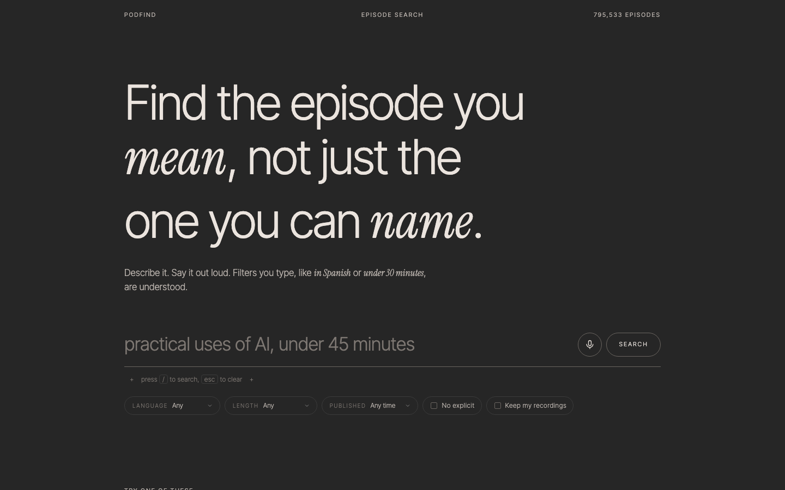
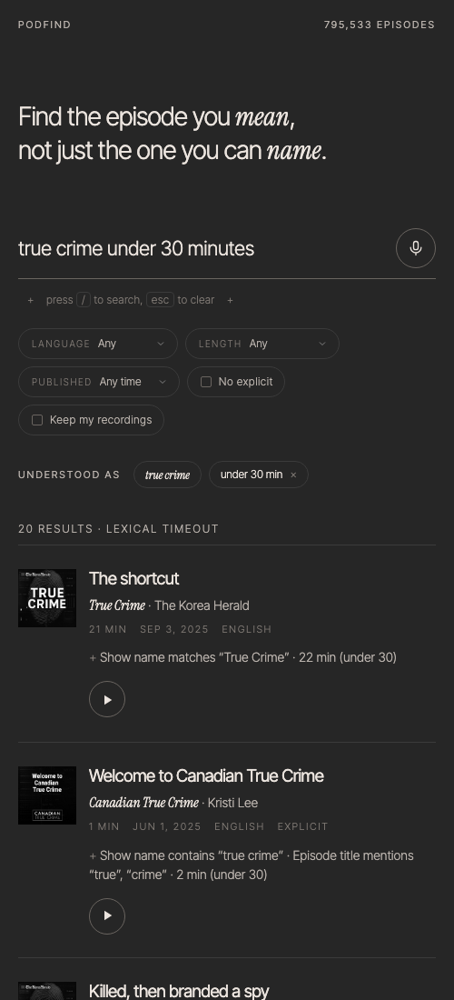

# The web app

The app is three static files in `web/static` (`index.html`, `style.css`,
`app.js`) plus an icon and a manifest, embedded into the API binary and
served at `/`. No framework and no build step: it deploys with the `api`
service and adds no runtime. Every behaviour runs through the public API
([14-serving.md](14-serving.md), [15-voice.md](15-voice.md)).

## Design

Charcoal background, warm off-white type, one display face (Inter Tight,
light, tightly tracked) with an italic serif (Instrument Serif) for the
accented words, tracked uppercase labels in the corners, outlined
controls that fill on hover, small plus ornaments, and space. No colour:
artwork is desaturated until a row is hovered or playing. A light theme
inverts the palette (footer toggle, remembered per browser). Fonts load
with `font-display: optional` behind a non-blocking stylesheet, so a slow
font never shifts the layout; the system stack renders until it arrives.

## Structure and states

- **Masthead:** name, section, catalog size (read from the API's index
  metrics; the static figure stands in if `/metrics` is unreachable).
- **Hero:** the headline, which compacts once results arrive.
- **Search:** one input with the microphone and the submit button, show
  and publisher names suggested from two characters on, filters as pills (language, length, published, explicit, keep
  recordings). Typed filters are understood by the API; sent filters and
  parsed ones alike are echoed back as chips under *Understood as*, each
  removable, and removing one re-runs the search on the understood text.
- **Voice:** tapping the microphone records with a live level meter in
  place of the input; tapping again sends the recording. The transcript
  is shown with language, length and confidence, editable in the input,
  and whether the recording was kept.
- **Results:** numbered rows with artwork, title, show and publisher,
  duration, date, language and an explicit flag, the server's
  explanation, a play button, and *More like this*, which opens the five
  nearest episodes from the learned index under the row (other shows
  first), each playable. While a search runs, skeleton rows
  take their place. No results shows an empty state with advice; a
  failed search shows the error in the status line, which also reports
  degraded retrieval legs.
- **Player:** one shared `<audio>` in a fixed bar: artwork, title, show,
  back 15 s, play/pause, forward 30 s, seek, close. The playing row is
  highlighted. Media-session metadata puts the episode on the lock
  screen.
- **Your data:** a dialog (footer link) explaining what the session
  stores, with export and delete.
- **Examples:** five queries to try before the first search.

Keyboard: `/` focuses the search, `Esc` clears it, Enter searches.
Shareable URLs: `/?q=…` runs the search on load and the address bar
follows each search.

## Events

The app sends what the API attributes server-side from the stored
search: one impression per rendered result with its displayed rank, and
playback `start`, `progress` (every 30 s), `complete`, and `skip` (moving
to another episode before 90% of the current one). Voice transcripts the
user edits before searching are sent as `voice_edited` with the voice
search's id, so transcription errors can be studied.

## Accessibility and performance

Lighthouse 12, mobile emulation and desktop, on the results page
(`/?q=history of rome`) against the local stack, 2026-10-28:

| category | mobile | desktop |
|---|---|---|
| performance | 100 | 94 |
| accessibility | 100 | 100 |
| best practices | 100 | 100 |
| SEO | 100 | 100 |

Cumulative layout shift is 0.01 on the results page and 0 on the home
page: artwork has fixed dimensions, the shared URL path lays the page out
for results before they land, and fonts never swap. Contrast is at least
4.5:1 for every text colour in both themes, every control has a label,
focus is visible, and reduced-motion preferences disable the animations.

## Not built

A separate episode page (the row expands in place instead), and offline
caching through a service worker.
